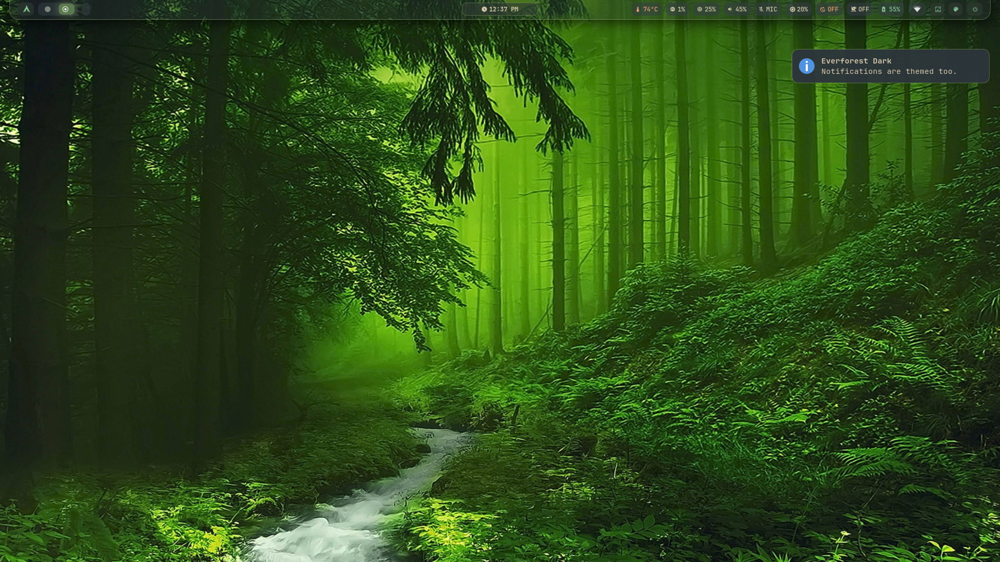

# Niri Everforest Rice

A Niri + Waybar rice with a centered clock, themed notifications, a wallpaper picker, a rofi power menu, and nine switchable color themes.



## Included

- Niri configuration with rounded corners, blur, animations, and workspace binds
- Waybar notch with workspaces, MPRIS, clock, system stats, microphone, nightlight, caffeine, battery, tray, wallpaper, theme, and power controls
- Nine themes: `catppuccin-mocha`, `everforest-dark`, `glass-macos`, `gruvbox-dark`, `kanagawa`, `nord`, `obsidian-crimson`, `rose-pine`, `tokyo-night`
- Theme switcher that syncs Waybar, Niri, Kitty, Rofi, GTK, icons, Zsh prompt, Swaylock, and Mako
- Wallpaper picker with thumbnails and next/random controls
- Rofi power menu and themed notifications
- Kitty, Rofi, Swaylock, and Mako theme assets
- Included wallpapers and a preview screenshot

The default theme is `everforest-dark` and the default wallpaper is `green.png`.

Tested on Arch Linux with Niri 26.04, Waybar 0.16, Kitty 0.51, Rofi 2.1, and Mako 1.11.

## Requirements

Both Arch Linux and CachyOS use `pacman`. Install the official packages first:

```bash
sudo pacman -S niri waybar kitty rofi mako swaylock python awww grim imagemagick \
  brightnessctl pamixer playerctl cliphist wl-clipboard pavucontrol polkit-gnome \
  gammastep ttf-jetbrains-mono-nerd noto-fonts tela-circle-icon-theme-all \
  gnome-themes-extra materia-gtk-theme
```

Optional official packages:

```bash
sudo pacman -S btop nwg-look xsettingsd swaybg
```

The Catppuccin GTK theme, Nordic GTK theme, and Bibata cursor are AUR packages on vanilla Arch:

```bash
paru -S catppuccin-gtk-theme-mocha nordic-theme bibata-cursor-theme-bin
```

Zen Browser is optional and also AUR:

```bash
paru -S zen-browser-bin
```

Use `yay` instead of `paru` if that is your AUR helper. CachyOS may provide some of these packages in its own repositories, so only install from the AUR if `pacman` cannot find them.

The rice uses Catppuccin, Materia, Nordic, and Adwaita GTK themes, the Tela Circle icon set, Bibata cursor, JetBrainsMono Nerd Font, and Noto Sans. These are not bundled in this repository. Missing optional visuals produce warnings; the installer still completes and applications use fallback themes.

## Install

```bash
git clone https://github.com/YOUR-USER/niri-rice.git
cd niri-rice
./install.sh
```

Choose a different theme or wallpaper:

```bash
./install.sh --theme glass-macos
./install.sh --theme catppuccin-mocha --wallpaper grovebox.png
```

Preview the changes without touching any files:

```bash
./install.sh --dry-run
```

The installer backs up existing files to `~/.rice-backup-<timestamp>` before copying. Wallpapers already present in `~/Pictures/Wallpapers` are not overwritten. It also installs the included `zshrc` as `~/.zshrc`.

Log out and back in if Niri does not reload automatically.

## Keybinds

| Keys | Action |
| --- | --- |
| `Alt+Return` | Open Kitty |
| `Mod+D` | Open Rofi launcher |
| `Mod+Z` | Open Zen Browser |
| `Alt+T` | Theme picker |
| `Alt+W` | Wallpaper picker |
| `Alt+Shift+W` | Next wallpaper |
| `Super+Alt+L` | Lock screen |
| `Print` | Screenshot |
| `Mod+O` | Overview |
| `Mod+Q` | Close window |
| `Mod+Shift+E` | Quit Niri |

## Themes

Switch themes with `Alt+T`, the Waybar theme button, or:

```bash
~/.config/themes/apply.sh <theme>
```

List themes:

```bash
~/.config/themes/apply.sh --list
```

Cycle themes:

```bash
~/.config/themes/apply.sh --next
```

Each theme directory contains Waybar CSS, Kitty colors, Rofi styles, a Zsh prompt, Niri colors, Swaylock colors, Mako notification styling, and metadata.

## Notes

- Mako notifications follow the active theme, including icons and critical notification borders.
- The Glass macOS theme keeps translucent notifications but does not blur behind them. Mako uses a full-screen layer surface, so Niri blur would blur the entire desktop.
- If notifications are not running, start Mako with:

```bash
systemctl --user enable --now mako.service
```

- Wallpapers are included for convenience. Replace them with your own images in `~/Pictures/Wallpapers` and check their licenses before redistributing.
- The installer requires a graphical Wayland session for the final wallpaper step. It uses `awww` when available, then `swww`, then `swaybg`. If the selected daemon is not running, it will try to start it.

## Publish to GitHub

Create an empty repository on GitHub, then:

```bash
cd ~/niri-rice
git init -b main
git add .
git commit -m "Initial rice"
git remote add origin git@github.com:YOUR-USER/niri-rice.git
git push -u origin main
```

With GitHub CLI:

```bash
cd ~/niri-rice
git init -b main
git add .
git commit -m "Initial rice"
gh repo create niri-rice --public --source=. --remote=origin --push
```
